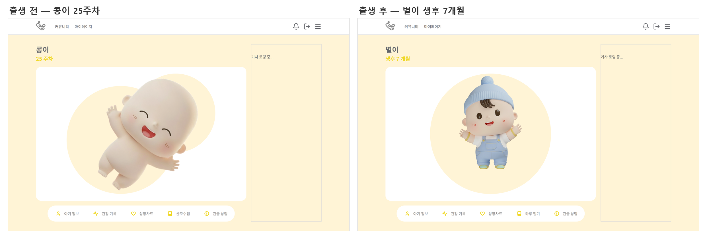
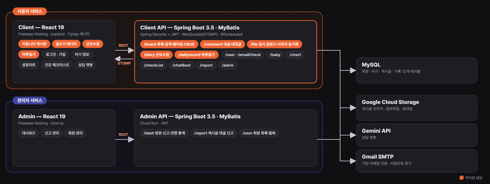
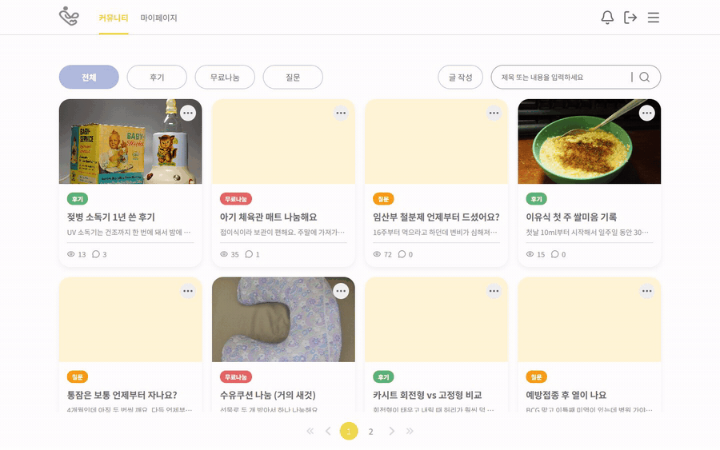
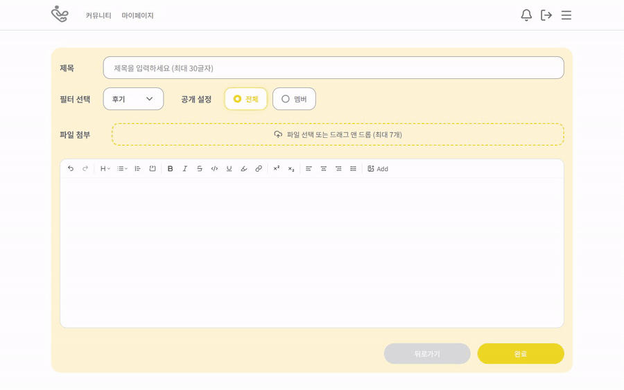
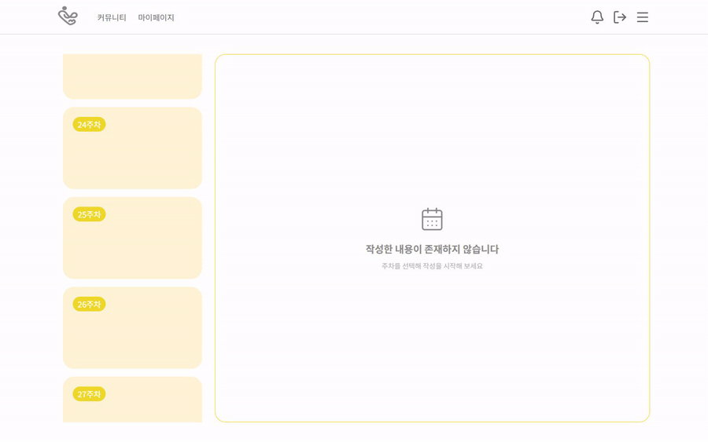
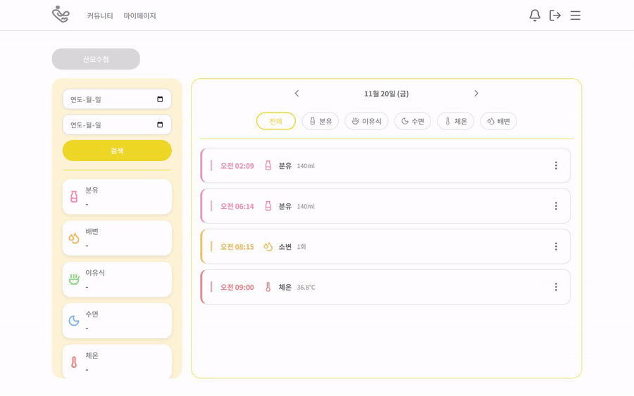

<div align="center">

# 🔔 코코벨 (CoCoBell) — 임신 · 육아 기록 서비스

**임신 주차부터 아기의 하루까지, 가족이 함께 쓰는 기록장**

산모수첩과 하루일기로 기록하고, 성장차트와 건강 체크리스트로 챙기고,<br>
커뮤니티에서 다른 부모와 이야기하는 웹 서비스



</div>

<br>

## 0. 담당 파트 — 커뮤니티 게시판, 산모수첩, 하루일기 (프론트 + 백엔드)

> 사용자 서비스에서 **커뮤니티 게시판**(목록 · 검색 · 글쓰기 에디터 · 첨부파일 · 댓글)과 **산모수첩 · 하루일기**를 화면부터 API · SQL까지 맡았습니다. 사용자 React 프로젝트의 초기 세팅과 팀 Pull Request 병합도 담당했습니다.<br>
> React · zustand · Tiptap · Spring Boot · MyBatis · MySQL · Google Cloud Storage

| 기능 | 한 일 |
| :--- | :--- |
| **게시판 목록** | 카테고리(후기 · 무료나눔 · 질문) 버튼 필터, 제목 · 내용 검색, 페이지 네비, 썸네일 카드 |
| **글쓰기 · 수정** | Tiptap 에디터 이미지 업로드, 첨부파일 박스(최대 7개), 첫 이미지로 썸네일 자동 지정, 수정 시 바뀐 파일만 전송 |
| **파일 처리** | 에디터 이미지 임시 업로드 → 글 저장 때 확정 · 빠진 이미지 삭제, 매일 04시 남은 임시 파일 정리 |
| **글 공개 범위** | 전체 공개 / 회원 공개 글을 SQL 조건 하나로 구분 |
| **댓글** | 댓글 · 대댓글, 답글이 달린 댓글은 지워도 자리만 남기기 |
| **산모수첩** | 임신 주차별 일기 목록 · 작성 · 수정 · 삭제, 가족이 쓴 글과 내 글 구분 |
| **하루일기** | 분유 · 이유식 · 수면 · 체온 · 배변 기록, 날짜 이동 · 종류 필터, 자정을 넘는 수면 나눠 저장, 수면 시간 겹침 검사 |
| **협업** | React 프로젝트 초기 세팅, 사용자 서비스 Pull Request 병합 |

<br>

## 1. 프로젝트 소개

**코코벨**은 임신부터 육아까지 아기의 기록을 가족이 함께 남기는 서비스입니다.

- 가입할 때 **가족 코드**로 묶이면 엄마 · 아빠가 같은 아기의 기록을 함께 봅니다.
- 아기의 출생 예정일이 지나기 전에는 **산모수첩**(임신 주차별 일기), 태어난 뒤에는 **하루일기**(수유 · 수면 · 배변 기록)가 열립니다.
- 성장차트 · 건강 체크리스트 · 상담 챗봇과, 부모끼리 이야기하는 **커뮤니티**가 있습니다.
- 관리자 서비스에서는 방문 통계와 신고된 글 · 댓글, 회원을 관리합니다.

| 항목 | 내용 |
| :--- | :--- |
| 기간 | 2025.11.17 ~ 2025.12.11 (약 4주) |
| 인원 | 5명 |
| 형태 | 팀 웹 프로젝트 — 사용자 · 관리자 서비스를 각각 React + Spring Boot로 분리 |

| 저장소 | 내용 |
| :--- | :--- |
| [CS_3_Client_React](https://github.com/jaann20914-eng/CS_3_Client_React) | 사용자 화면 (React) |
| [CS_3_Client_Boot](https://github.com/jaann20914-eng/CS_3_Client_Boot) | 사용자 API (Spring Boot) |
| [CS_3_Admin_React](https://github.com/jaann20914-eng/CS_3_Admin_React) | 관리자 화면 (React) |
| [CS_3_Admin_Boot](https://github.com/jaann20914-eng/CS_3_Admin_Boot) | 관리자 API (Spring Boot) |

<br>

---

## 2. 서비스 구성



```text
코코벨 (사용자)
├── 회원          로그인 · 회원가입(이메일 인증 · 가족 코드) · 아이디 / 비밀번호 찾기
├── 홈            아기 카드(주차 · 개월 수) · 기능 바로가기
├── 아기 정보     아기 등록 · 전환 · 마이페이지
├── 커뮤니티      목록 · 검색 · 글쓰기 에디터 · 첨부파일 · 댓글 · 신고        ← 담당
├── 산모수첩      임신 주차별 일기                                            ← 담당
├── 하루일기      분유 · 이유식 · 수면 · 체온 · 배변 기록                     ← 담당
├── 성장차트      키 · 몸무게 · 태아 추정 체중 그래프
├── 건강 기록     검사 · 접종 체크리스트
├── 상담 챗봇     Gemini
└── 알림          내 글 · 댓글에 달린 댓글 실시간 알림 (WebSocket)

코코벨 (관리자)
└── 대시보드 · 신고 관리 · 회원 관리
```

<br>

---

## 3. 주요 기능

> 화면은 저장소 코드를 로컬에서 실제로 실행해 녹화했습니다. 저장소에 DB 스크립트가 없어 MyBatis 매퍼에 맞춰 MySQL 테이블을 만들고 예시 데이터를 넣었습니다. 파일 저장은 Google Cloud Storage 대신 로컬 폴더로 바꿔 실행했습니다. 게시글 사진은 Wikimedia Commons의 공개 사진입니다(맨 아래 출처).

### 3.1 커뮤니티 게시판 (담당)



- **카테고리 버튼**(전체 · 후기 · 무료나눔 · 질문)과 **제목 · 내용 검색**을 함께 걸 수 있고, 결과는 페이지 단위로 받아옵니다.
- 카드에는 글의 **첫 이미지로 만든 썸네일**이 붙습니다. 썸네일이 있는 글만 한 번에 모아 조회합니다.
- 글마다 **전체 공개 / 회원 공개**를 고를 수 있습니다. 로그인하지 않은 사람에게는 회원 공개 글이 목록 · 검색 · 개수 어디에도 나오지 않습니다.
- 상세 화면 오른쪽에서 **댓글 · 대댓글**을 달고, 글쓴이는 글을 수정 · 삭제합니다.

### 3.2 글쓰기 에디터와 파일 (담당)



- 본문은 **Tiptap 에디터**로 쓰고, 이미지를 넣는 순간 서버에 **임시 파일**로 올라가 에디터에 바로 보입니다.
- 완료를 누르면 본문 속 이미지 목록을 서버에 보내 **남은 이미지만 확정**하고, 쓰다가 지운 이미지는 저장소에서도 지웁니다.
- 본문의 **첫 이미지가 썸네일**이 됩니다. 위 GIF에서 글을 올리자 목록 첫 카드에 사진이 붙습니다.
- 첨부파일은 따로 최대 7개까지 올리고, 상세 화면에서 내려받습니다.

### 3.3 산모수첩 (담당)



- 출생 예정일로 계산한 **임신 주차**마다 카드가 있고, 주차를 누르면 그 주에 쓴 일기들이 펼쳐집니다.
- 일기는 에디터로 쓰고 읽습니다. 같은 가족 코드의 엄마 · 아빠가 함께 쓰고, **내가 쓴 글만** 수정 · 삭제 버튼이 나옵니다.

### 3.4 하루일기 (담당)



- 아기가 태어난 뒤에는 **분유 · 이유식 · 수면 · 체온 · 배변**을 시간 순으로 기록합니다. 날짜를 넘기거나 종류로 걸러 봅니다.
- 위 GIF에서는 **밤 10시 30분 ~ 새벽 3시 10분** 수면을 넣었습니다. 자정을 기준으로 **19일 1시간 30분 + 20일 3시간 10분**으로 나뉘어 각 날짜에 보입니다.
- 이미 있는 수면 기록과 시간이 겹치면 저장하지 않고 알려 줍니다.

### 3.5 그 밖의 기능 (팀원 담당)

- 회원가입 · 이메일 인증 · 가족 코드, 아기 등록과 전환, 마이페이지
- 성장차트(echarts), 건강 체크리스트, Gemini 상담 챗봇, 댓글 실시간 알림(STOMP)
- 관리자 대시보드(chart.js) · 신고 처리 · 회원 관리

<br>

---

## 4. 구현 포인트 (담당 코드)

### 4.1 에디터 이미지: 먼저 올리고, 저장할 때 정리

```text
이미지 삽입 ─▶ POST /file/tempupload ─▶ 저장소 + file_info(target_seq 없음)
글 저장     ─▶ 본문 JSON에서 이미지 이름 목록 추출 ─▶ syncBoardImages
               ├─ 목록에 있는 이미지 → target_seq 연결(확정)
               └─ 기존 이미지 중 목록에 없는 것 → 저장소 · DB에서 삭제
매일 04:00  ─▶ 끝내 확정되지 않은 임시 파일 삭제 (@Scheduled)
```

- 에디터 이미지 업로드 노드: `src/@/components/tiptap-node/image-upload-node/image-upload-node.jsx`
- 본문에서 이미지 목록 추출, 첫 이미지 썸네일: `src/notmember/boardIndex/boardWrite/UseBoardWrite.js`
- 확정 · 삭제 · 임시 파일 정리: `CS_3_Client_Boot` `file_info/FileService.java` (`syncBoardImages`, `cleanUpTemp`)

### 4.2 글 + 파일 + 댓글을 한 트랜잭션으로

- `BoardFacadeService`(`@Transactional`)가 **글 저장과 첨부파일**, **글 삭제와 파일 · 댓글 삭제**를 한 단위로 묶습니다.
- 수정할 때는 화면이 원래 파일과 비교해 **지운 파일 번호만**(`deletedFiles`) 보냅니다. 서버는 썸네일 교체 · 파일 삭제 · 새 파일 추가 · 본문 이미지 정리를 한 번에 처리합니다.
- 페이징 계산과 목록 조회는 컨트롤러에서 서비스로 옮겨 정리했습니다.

### 4.3 공개 범위는 SQL 조건 하나로

```xml
<!-- board-mapper.xml -->
AND is_privated <= #{is_privated}   <!-- 로그인: 1(전부) · 비로그인: 0(전체 공개만) -->
```

- 로그인 여부를 `true/false`로 넘기면 목록 · 검색 · 개수 쿼리가 모두 같은 조건으로 회원 공개 글을 거릅니다.

### 4.4 답글이 있는 댓글 지우기

- 답글이 달린 댓글은 지워도 행을 남기고 `is_deleted = 1`로 표시만 해서 대화 흐름이 끊기지 않게 했습니다.
- 마지막 답글이 지워지면, 이미 지워진 표시만 남아 있던 부모 댓글도 그때 함께 지웁니다. (`comment/CommentService.java`)

### 4.5 자정을 넘는 수면 기록

- 수면 한 번에 `sleep_group_id`(UUID)를 붙이고, 자정을 넘으면 **날짜별 조각**으로 나눠 여러 행을 한 번에 저장합니다(MyBatis `<foreach>`).
- 저장 전에 **전날 ~ 다음 날** 수면 기록을 불러와(`/dailyrecord/sleep-range`) 시간이 겹치는지 검사합니다.
- 수정 · 삭제는 같은 `sleep_group_id`의 조각을 함께 다룹니다.
- 화면: `src/member/diaryIndex/born/everydayWrite/UseEverydayWrite.js` · SQL: `daily_record-mapper.xml`

<br>

---

## 5. 기술 스택

| 분류 | 기술 |
| :--- | :--- |
| **Frontend** | React 19.2, React Router 7, zustand 5, axios, Tiptap 3, echarts 6, framer-motion, SockJS + STOMP, browser-image-compression |
| **Backend** | Java 21, Spring Boot 3.5, Spring Security + JWT(java-jwt), MyBatis 3, WebSocket(STOMP), Spring Mail, `@Scheduled` |
| **Database** | MySQL |
| **Storage · 외부 API** | Google Cloud Storage, Gemini API(google-genai), Gmail SMTP |
| **배포** | Firebase Hosting(화면), Cloud Run(관리자 API) |
| **관리자 화면** | React 19.2, chart.js 4 |

<br>

---

## 6. 팀원

| 이름 | 담당 |
| :-: | :--- |
| [박지원](https://github.com/jaann20914-eng) | 커뮤니티 게시판 · 글쓰기 에디터 · 파일 처리 · 댓글, 산모수첩, 하루일기 (프론트 + 백엔드), React 초기 세팅 · PR 병합 |
| [dayun-50](https://github.com/dayun-50) | 회원 · 인증(JWT) · 이메일 인증, 아기 정보, 댓글 실시간 알림, 상담 챗봇, 신고, 건강 체크리스트, 관리자 API |
| [tmd0487](https://github.com/tmd0487) | 아기 · 부모 정보 · 마이페이지 화면, 관리자 대시보드 · 신고 · 회원 화면 |
| [Fuigang](https://github.com/Fuigang) | 성장차트, 임신 주차 계산 |
| [장영서](https://github.com/jangyeongseo) | 화면 디자인 · 공통 헤더 · 게시판 · 일기 · 차트 · 체크리스트 UI |

> 관리자 저장소(CS_3_Admin_*)는 팀 원본 저장소를 fork한 것입니다. 코드는 그대로 두고 README만 정리했습니다.

<br>

<details>
<summary>사진 출처 (Wikimedia Commons)</summary>

| 사진 | 원본 | 작성자 | 라이선스 |
| :--- | :--- | :--- | :--- |
| 젖병 소독기 | [Baby bottle warmer BW 2026-10-01 16-28-53.jpg](https://commons.wikimedia.org/wiki/File:Baby_bottle_warmer_BW_2026-10-01_16-28-53.jpg) | Berthold Werner | CC BY-SA 4.0 |
| 쌀미음 | [Rice porridge at home.jpg](https://commons.wikimedia.org/wiki/File:Rice_porridge_at_home.jpg) | JIP | CC BY-SA 4.0 |
| 수유쿠션 | [Breastfeeding pillow.jpg](https://commons.wikimedia.org/wiki/File:Breastfeeding_pillow.jpg) | Panek | CC BY-SA 4.0 |

</details>
